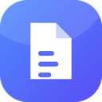
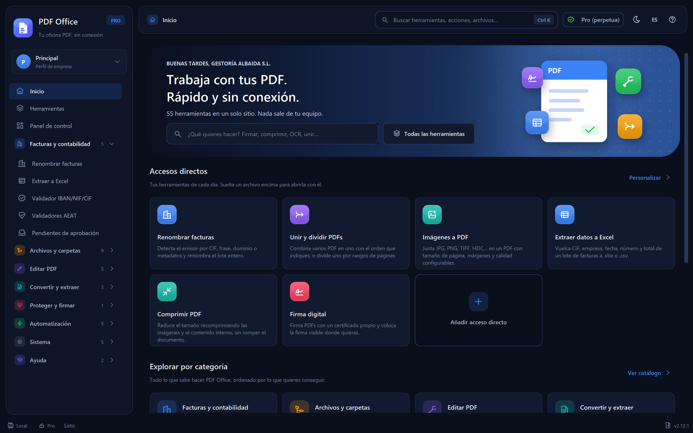
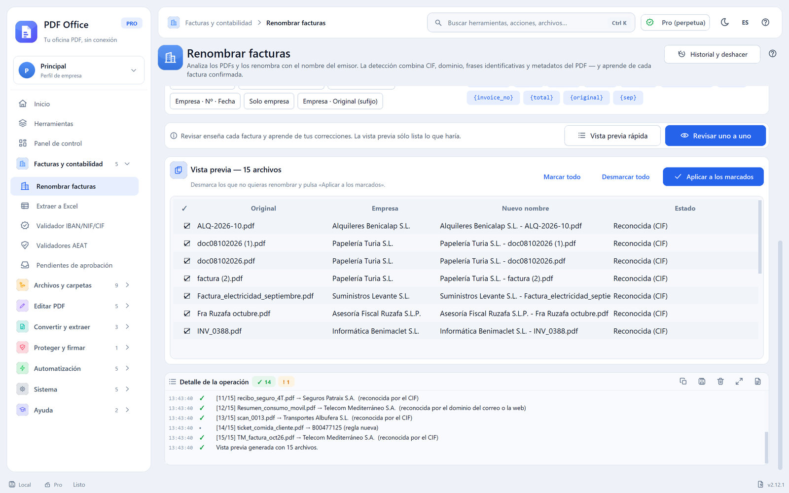
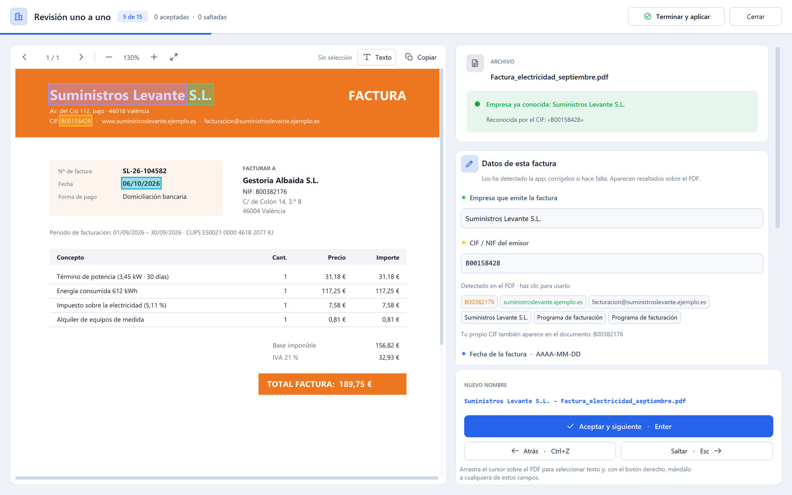
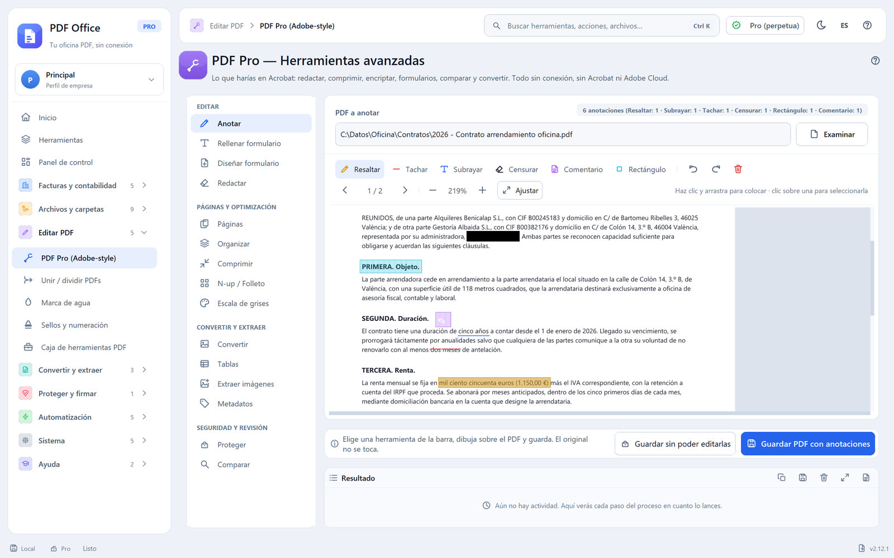
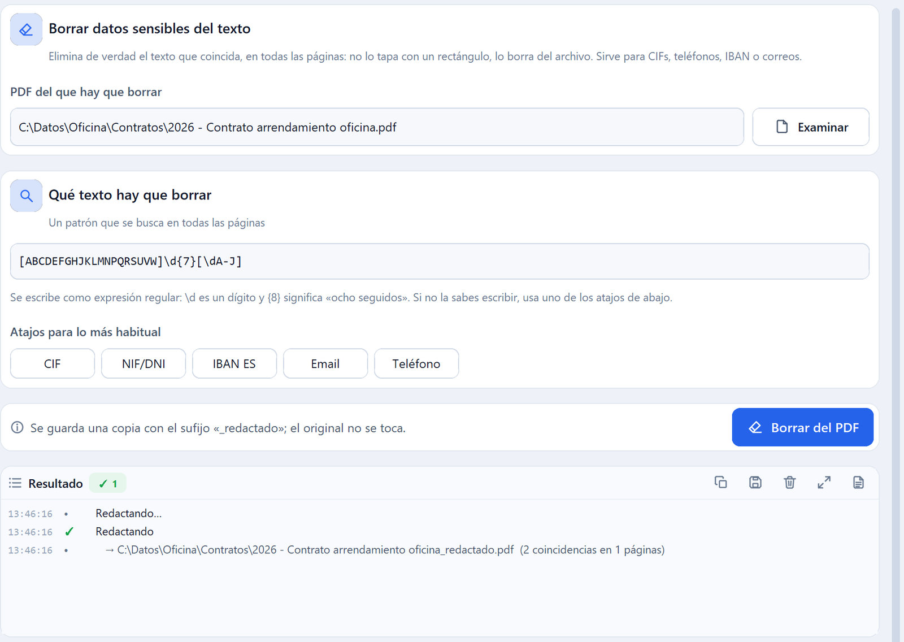
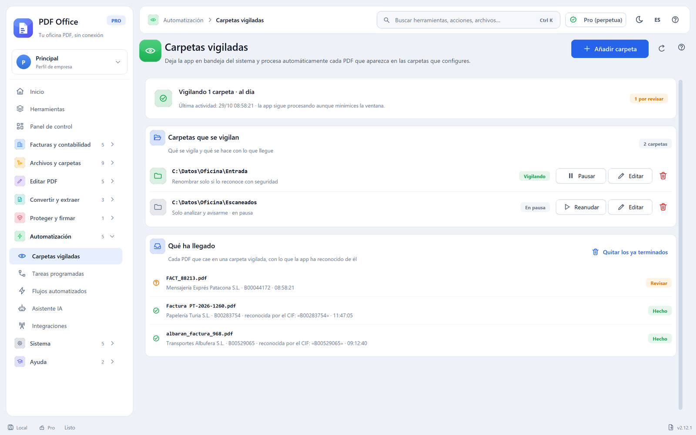
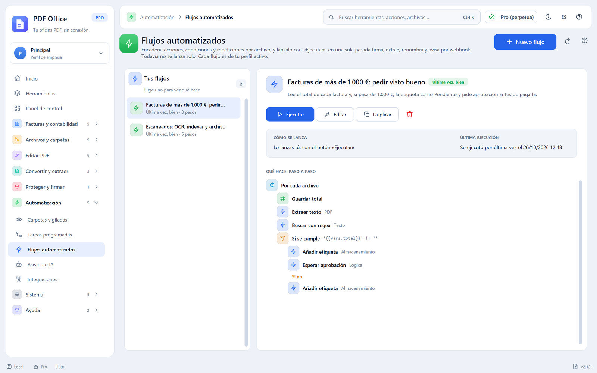
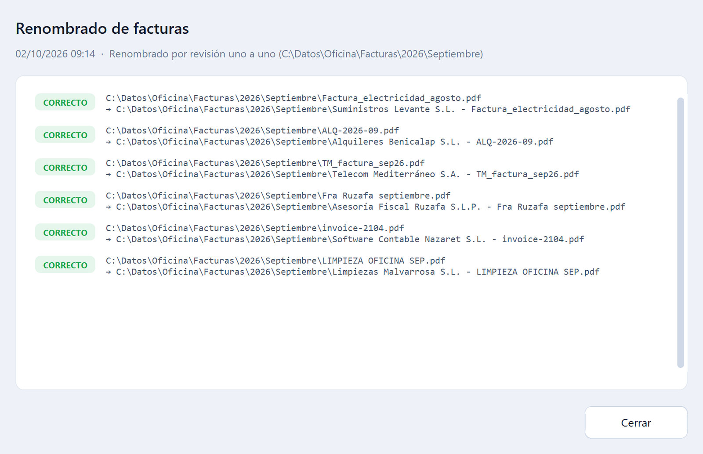

<p align="center">
  
</p>

<h1 align="center">PDF Office</h1>

<p align="center">
  Tu oficina PDF, sin conexión. Facturas, archivos y documentos PDF en una sola app de escritorio para Windows.
</p>

<p align="center">
  <a href="https://github.com/Rannden-SHA/PDF-Office/releases/latest"></a>
  
  <a href="LICENSE"></a>
</p>

<p align="center">
  <a href="https://github.com/Rannden-SHA/PDF-Office/releases/latest"><strong>Descargar la última versión</strong></a>
  &nbsp;·&nbsp;
  <a href="https://github.com/Rannden-SHA/PDF-Office/releases/latest">Manual de usuario (PDF)</a>
  &nbsp;·&nbsp;
  <a href="#versión-gratuita-y-versión-pro">Gratuita y Pro</a>
  &nbsp;·&nbsp;
  <a href="#manual-y-soporte">Soporte</a>
</p>



## Qué es PDF Office

PDF Office es una aplicación de escritorio para Windows que trabaja con tus PDF dentro de tu equipo. Coge una carpeta
llena de documentos y la deja renombrada, clasificada y exportada sin abrir los archivos uno a uno. Además reúne en un
solo sitio lo que se le suele hacer a un PDF: unirlo, dividirlo, comprimirlo, firmarlo, protegerlo, convertirlo o
sacarle el texto a un escaneado.

Su herramienta principal es **Renombrar facturas**: lee cada factura, reconoce qué empresa la emitió (por su CIF, por
una frase, por el dominio de su web o por los datos del PDF) y le pone el nombre con el formato que elijas. La primera
vez le indicas quién es cada proveedor; a partir de ahí lo reconoce sola.

Está pensada para gestorías, asesorías, departamentos de administración y cualquier oficina que mueve facturas y
documentos en PDF a diario y no quiere subirlos a un servicio en la nube.

**55 herramientas** organizadas en siete categorías, con la misma forma de trabajar en todas:

- **Primero lo ves, después pasa.** Las herramientas que renombran o mueven archivos en lote enseñan antes una vista
  previa, archivo por archivo, y puedes desmarcar lo que no quieras.
- **Todo se puede deshacer.** Cada operación queda en el Historial con el nombre y la ubicación de cada archivo antes y
  después.
- **El original no se toca.** Las herramientas de edición guardan una copia nueva junto al archivo de partida.
- **Cada empresa, en su perfil.** Si llevas varias sociedades, cada una tiene sus empresas reconocidas, su historial y
  sus automatizaciones, sin mezclarse.

La interfaz está disponible en español e inglés, con tema claro y oscuro.

## Funciones

### Facturas y contabilidad

- **Renombrar facturas.** Detecta el emisor por CIF, frase identificativa, dominio o metadatos del PDF y renombra el
  lote entero con la plantilla que elijas (empresa, número, fecha, total, nombre original…). La revisión uno a uno
  muestra la factura con los datos detectados resaltados y aprende de cada corrección.
- **Extraer datos a Excel.** Vuelca CIF, empresa, fecha, número y total de un lote de facturas a `.xlsx` o `.csv`.
- **Validador NIF / CIF / IBAN.** Comprueba el formato y la letra o el dígito de control de NIF, NIE, CIF e IBAN.
- **Facturae y firmas AEAT.** Valida facturas electrónicas Facturae 3.2, 3.2.1 y 3.2.2 (FACe) y comprueba quién firmó
  un PDF, si se ha modificado después y si el certificado es de la FNMT o de la Agencia Tributaria.
- **Pendientes de aprobación.** Bandeja de las solicitudes de visto bueno que crean los flujos automatizados: cada
  una se aprueba o se rechaza con una nota.





### Archivos y carpetas

- **Renombrado en lote:** prefijo y sufijo, numeración secuencial, buscar y reemplazar (con expresiones regulares) y
  normalizar nombres (tildes, mayúsculas y espacios).
- **Clasificar por contenido.** Reglas del tipo «si el PDF contiene X, muévelo a la carpeta Y», evaluadas en orden.
- **Organizar por fecha.** Reparte los archivos en subcarpetas por año y mes con la fecha de la factura o la del archivo.
- **Detectar duplicados.** Encuentra archivos de contenido idéntico (SHA-256) y los aparta en una papelera recuperable.
- **Etiquetas y búsqueda en el contenido.** Etiquetas de colores para marcar documentos y un índice local para buscar
  dentro de los PDF.

### Editar PDF

- **Editor PDF:** anotar (resaltar, subrayar, tachar, comentarios), diseñar y rellenar formularios, insertar, borrar,
  rotar y reordenar páginas, N-up y folleto, y escala de grises.
- **Unir y dividir PDF**, **marca de agua** y **sellos y numeración Bates**.
- **Utilidades rápidas:** rotar páginas, extraer páginas, eliminar páginas en blanco y comparar dos versiones de un
  documento.



### Convertir y extraer

- **Imágenes a PDF** (JPG, PNG, TIFF, HEIC…) con tamaño de página, márgenes y calidad configurables.
- **PDF a Word** editable (`.docx`).
- **OCR de escaneados:** añade una capa de texto para buscar y copiar en un PDF escaneado.
- **Comprimir PDF**, **PDF a imágenes**, **convertir a PDF/A** y **extraer tablas** (a CSV o Excel) e **imágenes**.

### Proteger y firmar

- **Firma digital** con tu certificado (`.pfx` o `.p12`) y firma visible donde la coloques, y **verificación** de las
  firmas que ya tiene un documento.
- **Proteger con contraseña** (AES-256) y **quitar la contraseña** cuando la conoces.
- **Censurar datos:** borra de verdad del archivo el texto sensible (CIF, NIF, IBAN, correos, teléfonos), no lo tapa con
  un rectángulo.
- **Metadatos:** leer, editar y limpiar autor, título y demás datos del PDF.



### Automatización

- **Carpetas vigiladas.** Cada PDF que cae en una carpeta se analiza, se renombra y se mueve solo; lo que no reconoce
  con seguridad queda pendiente de revisar.
- **Tareas programadas.** Cadenas de acciones (analizar, renombrar, mover, exportar a Excel) que se lanzan con un clic
  o, sin abrir la app, desde el Programador de tareas de Windows.
- **Flujos automatizados.** Pasos, bucles por archivo, condiciones con su rama «Si no» y peticiones de aprobación.
- **Integraciones.** Lectura de un buzón de correo (IMAP) y avisos por webhook a Slack, Teams o WhatsApp.
- **Asistente IA.** Clasifica documentos, extrae los datos de una factura y propone nombres con OpenAI, Anthropic o un
  modelo instalado en tu propio equipo (Ollama, LM Studio). Con un modelo local, el texto no sale de tu ordenador.





### Sistema

- **Panel de control** con la actividad, el tiempo ahorrado y las operaciones recientes.
- **Empresas y perfiles:** los datos de cada razón social en su propio perfil.
- **Historial y deshacer:** todas las operaciones registradas y reversibles archivo a archivo.
- **Ajustes:** tema, idioma, atajos, copias de seguridad y base de datos de empresas.
- **Centro de ayuda** con guías paso a paso y un modo práctica con documentos de ejemplo.



<sub>Las capturas muestran datos de ejemplo de una gestoría ficticia, Gestoría Albaida S.L. Todos los nombres, CIF e
importes son inventados.</sub>

## Versión gratuita y versión Pro

PDF Office se instala entera: no se esconde ninguna pantalla y la versión gratuita no caduca. La diferencia está en los
límites por lote y en los módulos que desbloquea la licencia. Cuando una operación pasa del límite, o usas una
herramienta que solo funciona con licencia, la app se detiene **antes de tocar ningún archivo**: no procesa ni los
primeros del lote.

| Herramienta | Versión gratuita | Versión Pro |
|---|---|---|
| Renombrar facturas | Hasta 5 PDF por lote, con la marca «[Free]» en el nombre | Sin límite y sin marca |
| Extraer a Excel | Hasta 5 PDF por lote | Sin límite |
| Clasificar por contenido y Organizar por fecha | Hasta 10 archivos por lote | Sin límite |
| Detectar duplicados | Hasta 20 archivos por lote | Sin límite |
| Prefijo / sufijo, Numeración secuencial, Buscar y reemplazar, Normalizar nombres | Hasta 10 archivos por lote, con la marca «[Free]» | Sin límite y sin marca |
| Unir y dividir PDF | Hasta 3 PDF por operación | Sin límite |
| Marca de agua | Hasta 5 PDF por lote | Sin límite |
| Editor PDF y caja de herramientas PDF (anotar, formularios, páginas, comprimir, PDF/A, contraseñas, censurar, metadatos…), sellos y numeración | Solo con licencia | Incluido con su módulo |
| Firma digital y verificación de firmas | Solo con licencia | Incluido con su módulo |
| PDF a Word, OCR, Facturae y firmas AEAT | Solo con licencia | Incluido con su módulo |
| Etiquetas y búsqueda en el contenido | Solo con licencia | Incluido con su módulo |
| Carpetas vigiladas, tareas programadas y flujos | Solo con licencia | Incluido con su módulo |
| Integraciones (correo y webhooks) | Solo con licencia | Incluido con su módulo |
| Perfiles de empresa | Solo el perfil «Principal» | Varios perfiles |
| Icono en la bandeja del sistema | No | Incluido con su módulo |
| Validador NIF / CIF / IBAN, Pendientes de aprobación, Imágenes a PDF (sin OCR), Asistente IA (con tu propia clave o un modelo local), panel, historial, ajustes y ayuda | Sin límite | Sin límite |

En las herramientas marcadas «Solo con licencia» puedes abrir la pantalla y ver cómo funciona; al ejecutar, aplicar o
guardar aparece el aviso de activación.

**Sobre la licencia Pro.** Se emite por módulos, de forma perpetua o por un periodo determinado, y puede ser **por
equipo** (ligada a la huella de ese equipo) o **de servidor**, con un número de puestos compartido a través de una
carpeta de red (SMB). Se activa sin conexión y sin crear ninguna cuenta: desde `Sistema › Licencia` generas un archivo
de petición, lo envías a NextCode Agency y cargas el archivo `.lic` que recibes. La petición solo contiene la huella
del equipo, el nombre de tu empresa y la versión de la app.

## Privacidad

- **Todo se procesa en tu equipo.** No hay nube ni cuenta de usuario, y tus documentos no se suben a ningún sitio.
- **Tus datos se quedan contigo.** Ajustes, perfiles, empresas reconocidas e historial se guardan en
  `%USERPROFILE%\.pdf-office`; tus documentos siguen donde los tengas.
- **Conexión solo cuando hace falta.** La app se conecta a internet para comprobar si hay una versión nueva y para las
  funciones que tú actives expresamente, como la lectura de un buzón de correo, los avisos a otros programas o el
  asistente IA con un proveedor externo. La licencia se activa sin conexión.
- **Modo servidor opcional.** Para compartir la base de empresas entre varios puestos se usa una carpeta de vuestra
  red local. Viene desactivado en una instalación nueva.

## Requisitos

- Windows 10 u 11 de 64 bits.
- No hacen falta permisos de administrador: se instala solo para tu usuario.
- Pantalla de 1366 × 768 o mayor.
- Internet solo para buscar actualizaciones y para las funciones opcionales que dependen de un servicio externo.
- Para el OCR, el programa gratuito [Tesseract OCR](https://github.com/UB-Mannheim/tesseract/wiki) instalado aparte con
  los idiomas español e inglés. Si falta, la pantalla `OCR` explica cómo instalarlo.
- Para la firma digital, tu certificado en un archivo `.pfx` o `.p12`.

## Instalación

1. Descarga `PDFOffice-Setup-<versión>.exe` desde la [última release](https://github.com/Rannden-SHA/PDF-Office/releases/latest).
2. Ábrelo, elige el idioma de la instalación (español o inglés) y acepta el acuerdo de licencia.
3. Revisa la carpeta de destino. Por defecto es `%LOCALAPPDATA%\Programs\PDF Office`.
4. Marca, si quieres, las tareas adicionales: acceso directo en el escritorio, iniciar con Windows en la bandeja del
   sistema y la opción «Renombrar con PDF Office» en el menú contextual de los PDF.
5. Pulsa **Instalar**. Al terminar, PDF Office se abre sola.

La primera vez se abre un asistente de seis pasos. El único obligatorio es el CIF o NIF de tu empresa: los CIF propios
nunca se toman como emisor de una factura. La licencia se puede activar en ese momento o más adelante.

Si actualizas desde una versión anterior no hace falta desinstalar: el instalador nuevo sustituye al anterior y
conserva tus datos, tu licencia y tus ajustes. Al desinstalar se borra el programa, pero no la carpeta
`%USERPROFILE%\.pdf-office`.

Si Windows SmartScreen muestra el aviso «Windows protegió su PC», comprueba que has descargado el instalador desde
esta página y pulsa «Más información» y «Ejecutar de todas formas».

## Actualizaciones y verificación

PDF Office comprueba al arrancar si hay una versión nueva en las releases de este repositorio. Si la hay, muestra las
novedades y, al pulsar **Descargar e instalar**, descarga el instalador, comprueba su SHA-256, se cierra y se vuelve a
abrir con la versión nueva. También puedes buscarla a mano en `Sistema › Ajustes › Versión y actualizaciones`.

Cada release incluye:

| Archivo | Contenido |
|---|---|
| `PDFOffice-Setup-<versión>.exe` | Instalador para Windows |
| `PDFOffice-Setup-<versión>.exe.sha256` | Huella SHA-256 del instalador |
| `PDF-Office-Manual-<versión>-es.pdf` | Manual de usuario en PDF |

Para verificar a mano un instalador descargado, abre PowerShell en la carpeta de descarga y compara el resultado con el
contenido del archivo `.sha256`:

```powershell
Get-FileHash .\PDFOffice-Setup-2.12.1.exe -Algorithm SHA256
Get-Content .\PDFOffice-Setup-2.12.1.exe.sha256
```

Las dos huellas deben coincidir (`Get-FileHash` la muestra en mayúsculas y el archivo `.sha256` en minúsculas). Las
novedades de cada versión están en la página de [releases](https://github.com/Rannden-SHA/PDF-Office/releases).

## Manual y soporte

- **Manual de usuario.** Instalación, recorrido por la pantalla, cada herramienta paso a paso, automatización, ajustes,
  solución de problemas, atajos, preguntas frecuentes y glosario. Se descarga en PDF desde cada
  [release](https://github.com/Rannden-SHA/PDF-Office/releases/latest), se instala junto al programa (menú Inicio de
  Windows, carpeta `PDF Office`) y se abre desde `Ayuda › Centro de ayuda › Manual de usuario (PDF)`.
- **Ayuda en la app.** Pulsa <kbd>F1</kbd> en cualquier pantalla para abrir su artículo del Centro de ayuda.
- **Soporte y licencias.** Escribe a [info@nextcodeagency.com](mailto:info@nextcodeagency.com) o visita
  [nextcodeagency.com](https://www.nextcodeagency.com).

## Licencia

PDF Office es software propietario. Su uso se rige por el [acuerdo de licencia de usuario final (EULA)](LICENSE), que
se acepta al instalar. Este repositorio publica los instaladores, el manual y las notas de cada versión.

## Créditos

Desarrollado por [NextCode Agency](https://www.nextcodeagency.com). © 2026 NextCode Agency. Todos los derechos
reservados.
